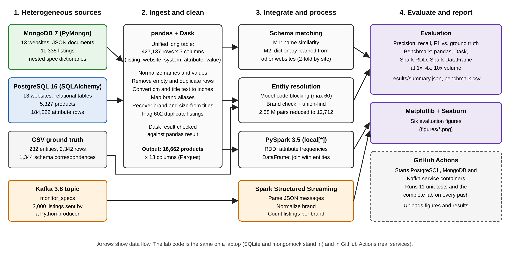
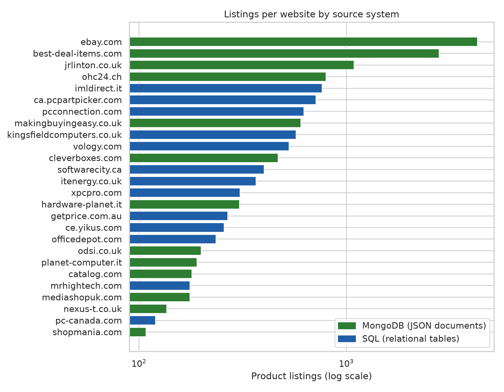
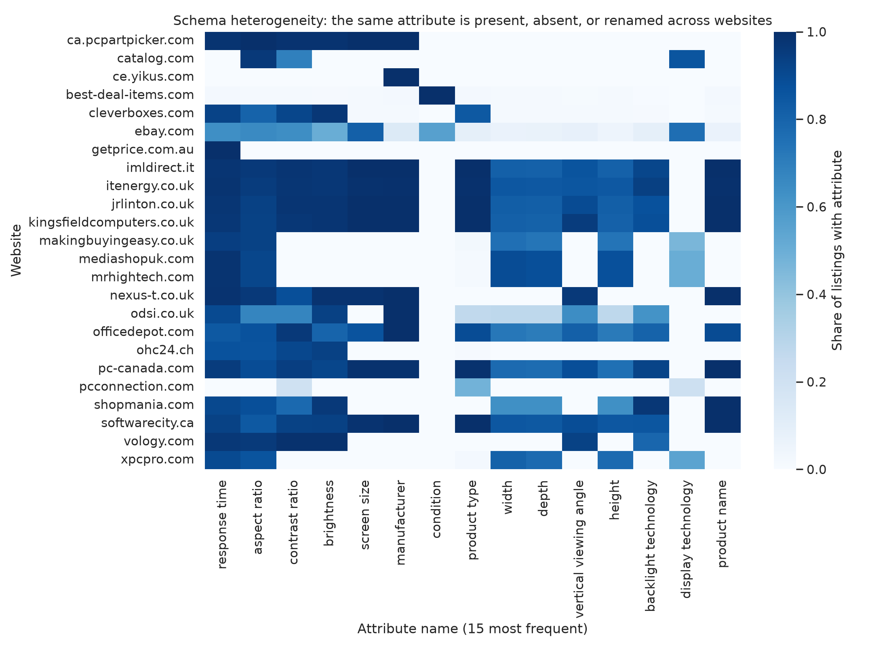
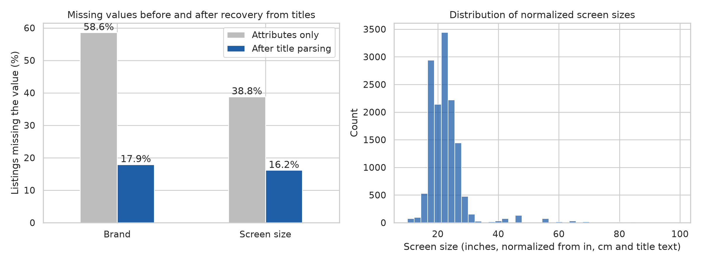
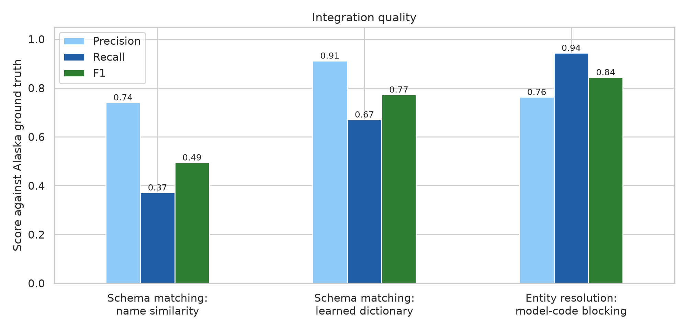
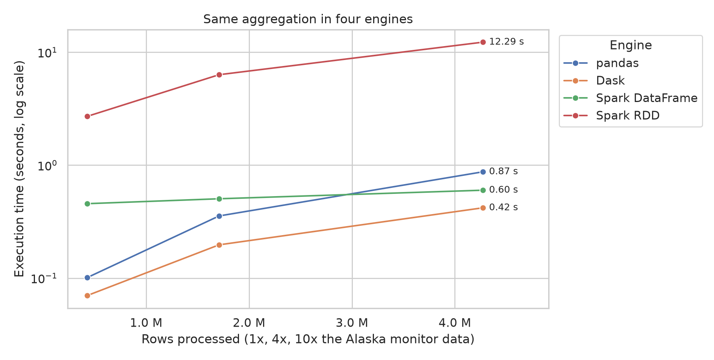
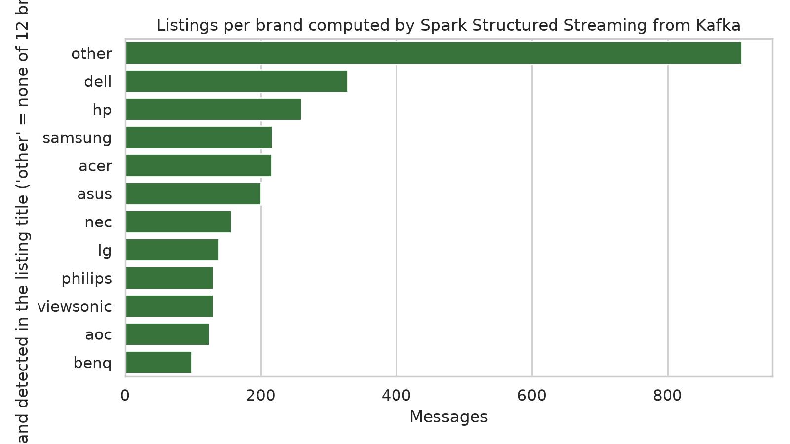

# Big Data Integration Techniques: Alaska Monitor Benchmark

DDS-8530 Big Data Integration, Week 6. Author: C. Elizabeth Brignoni Brignoni.

This lab integrates the **monitor** vertical of the Alaska benchmark (Crescenzi et al., 2021): **16,662 product listings from 26 e-commerce websites, described by 1,687 distinct attribute names**, with curated ground truth for schema matching (87 target attributes, 1,026 labeled source attributes) and entity resolution (232 real-world monitors, 2,273 labeled listings).



## What the pipeline does

| Stage | Tools | Module |
| --- | --- | --- |
| Distribute the data across heterogeneous systems: 13 websites as JSON documents in **MongoDB**, 13 as relational **SQL** tables (PostgreSQL in CI, SQLite locally), ground truth as **CSV** | PyMongo, SQLAlchemy, pandas | `scripts/build_sources.py` |
| Ingest every source into one unified long table | PyMongo, SQLAlchemy | `bdi/ingest.py` |
| Clean and transform: normalize names and values, remove empty and duplicate rows, flag duplicate listings, resolve unit and label inconsistencies (inch / cm / title text, brand aliases), recover missing values from page titles | pandas and **Dask** (results must agree) | `bdi/clean.py` |
| Distributed processing with both Spark APIs: **RDD** attribute frequencies, **DataFrame** join with the entity ground truth, and a **performance comparison** of pandas, Dask, Spark RDD and Spark DataFrame at 1x, 4x and 10x volume | PySpark | `bdi/spark_jobs.py` |
| Integration: **schema matching** (name similarity vs. a dictionary learned from other websites) and **entity resolution** (model-code blocking + union-find), scored against the ground truth | Python | `bdi/integrate.py` |
| Real-time ingestion: a producer streams listings into **Kafka**; **Spark Structured Streaming** parses and enriches each message | kafka-python, PySpark | `bdi/streaming.py` |
| Evaluation charts | Matplotlib, Seaborn | `bdi/visualize.py` |

## Run it

```bash
python -m venv .venv && source .venv/bin/activate   # Windows: .venv\Scripts\activate
pip install -r requirements.txt                       # Java 17 is required for PySpark
pytest -v
python run_all.py                                     # downloads Alaska, runs every stage
```

Without `MONGO_URI` the MongoDB step uses an in-memory mongomock database, and without `KAFKA_BOOTSTRAP` the streaming step is skipped. The GitHub Actions workflow (`.github/workflows/lab.yml`) starts real **PostgreSQL 16, MongoDB 7 and Apache Kafka 3.8** service containers and runs the complete lab, including streaming, on every push. Figures and `results/summary.json` are uploaded as a build artifact.

## Key results (GitHub Actions run with PostgreSQL 16, MongoDB 7 and Kafka 3.8; see results/summary.json)

| Measure | Result |
| --- | --- |
| Records integrated | 16,662 listings, 26 websites, 427,137 attribute values, 1,687 attribute names |
| Missing brand after attribute lookup only / after title parsing | 58.6% / 17.9% |
| Missing screen size after attribute lookup only / after title parsing | 38.8% / 16.2% |
| Schema matching F1: name similarity / learned dictionary | 0.49 / 0.77 |
| Entity resolution pairwise precision / recall / F1 | 0.76 / 0.94 / 0.84 |
| Candidate pairs: all pairs / after blocking | 2,582,128 / 12,712 (99.5% fewer) |
| Ground-truth issues found | 60 duplicate rows; 9 listings assigned to two entities |
| Kafka to Spark Structured Streaming | 3,000 messages in one micro-batch, 2.12 s (about 1,412 messages per second) |
| Same aggregation at 10x volume (4.27 M rows) | Dask 0.42 s, Spark DataFrame 0.60 s, pandas 0.87 s, Spark RDD 12.29 s |
| Full lab run time | 77.4 s (Spark jobs and benchmark 54.6 s) |

## Figures

| | |
| --- | --- |
|  |  |
|  |  |
|  |  |

## Source

Crescenzi, V., De Angelis, A., Firmani, D., Mazzei, M., Merialdo, P., Piai, F., & Srivastava, D. (2021). *Alaska: A flexible benchmark for data integration tasks* (arXiv:2101.11259). https://arxiv.org/abs/2101.11259. Data: https://github.com/merialdo/research.alaska
